# 3.2.0 — Arayüz yenilemesi ve düzeltmeler

Bu dal (`ui-ux-yenileme`) 3.1.3 üzerine kuruludur. `main` dalı değiştirilmedi; beğenilmezse `main`'e dönmek yeterli.

## Görsel ve hareket

- **Bugün kartı:** Günün saatine göre selamlama, yavaşça hareket eden renkli arka plan, parlayan kalan süre halkası, yuvarlanarak değişen büyük süre rakamları, "Uygulama / Kullanılan / Kısıtlı" özet kutuları. O an açık bir korunan uygulama varsa nabız atan bir noktayla ve girişte yazdığın amaçla gösterilir.
- **Alt menü:** Gerçek ikonlar ve seçili sekmenin altında yaylanarak kayan renkli gösterge.
- **Sekme geçişleri:** Sekmeler yön duyarlı kayarak ve solarak değişir; kartlar ekran açılırken sırayla yükselerek gelir.
- **Odak modu:** Açılır menü yerine tek dokunuşla seçilen 15/30/45/60/90 dk düğmeleri, degrade "Odağı başlat" düğmesi. Odak sürerken halka ve canlı geri sayım.
- **Uygulama kartları:** Basınca hafif küçülme, yaylı açılıp kapanma, dönen ok, renkli kullanım çubuğu, ikon menüsü.
- **Mola ekranı:** 4 sn nefes al / 4 sn nefes ver temposunda büyüyüp küçülen nefes çemberi, halka içinde geri sayım.
- **Bilinçli giriş:** Büyük süre düğmeleri, hazır amaç çipleri ("Mesaja cevap vereceğim" vb.), 5 saniyelik düşünme süresi düğmenin içinde dolan bir çubukla gösterilir. Bu ekrana açılış gecikmesi olmasın diye giriş animasyonu bilerek eklenmedi.
- Ayarlar grupları, plan kartları, bildirim çubuğu (snackbar) ve koyu tema aynı görsel dile uyarlandı.

## Çalışıyormuş gibi görünüp çalışmayan şeyler — düzeltildi

| Sorun | Ne yapıldı |
|---|---|
| Odak, program veya moladaki bir uygulamanın kartı yine "20 dk kaldı" yazıyordu. | Engelli kart artık nedenini ve ne zaman açılacağını gösteriyor ("Molada · 09:31"), engel kalkınca kalacak süreyi alt satırda veriyor. |
| Bilinçli girişte yazılan "Ne yapacağım?" amacı kaydediliyor ama hiçbir yerde gösterilmiyordu. | Amaç; Bugün kartında, uygulama kartında ve "oturum bitmek üzere" bildiriminde hatırlatılıyor. |
| "Yolculuk istisnası" 26–27 Eylül 2026 tarihine sabitti; tarih geçtiği için bir daha kullanılamıyordu. | Genel **Serbest zaman** özelliği: gün, saat ve süre seçilir. Anlık kaçamak olmasın diye en erken 1 saat sonrası (katı modda 24 saat) planlanabilir; bu kural arayüzde ve kayıt katmanında uygulanır. |
| Sıralamadaki "Engellenen" seçeneği "Akıllı" ile birebir aynı sıralamayı yapıyordu. | Seçenek kaldırıldı; sıralama açılır menü yerine çiplerle yapılıyor. |
| Ayarlar "Veriler yalnızca bu cihazda tutulur" diyordu, oysa hesap bağlıyken kullanım süreleri buluta eşitleniyor. | Metin hesap bağlıyken doğru bilgiyi gösteriyor. |
| Ortak kota satırı kartın dışında, düz metin olarak duruyordu. | Kartın içine renkli bir satır olarak taşındı. |

## Kurulum

`dist/doom-blocker-3.2.0-production-release.apk` mevcut uygulamanın **üzerine** kurulur (aynı imza, sürüm kodu 25). Uygulamayı kaldırma ve verilerini temizleme; kurallar ve sayaçlar korunur. Güncellemeden sonra Android erişilebilirlik servisini kapatırsa Ayarlar → Erişilebilirlik'ten yeniden aç.

## Ekran görüntüleri (emülatör)

| Önce | Sonra |
|---|---|
| 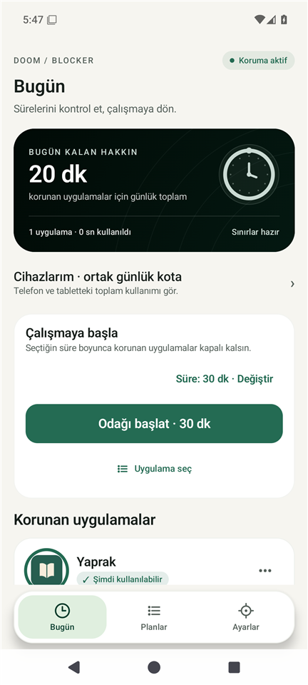 | 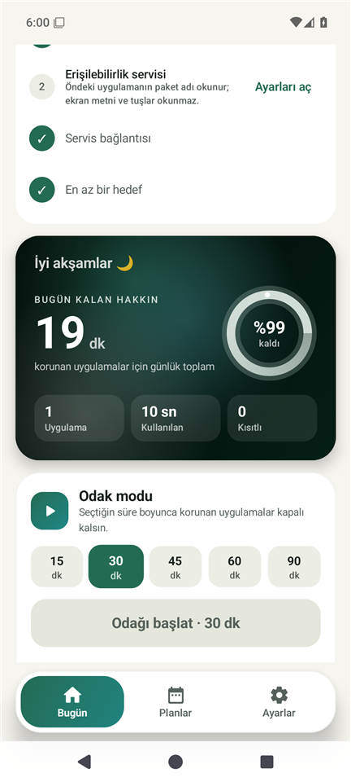 |
| 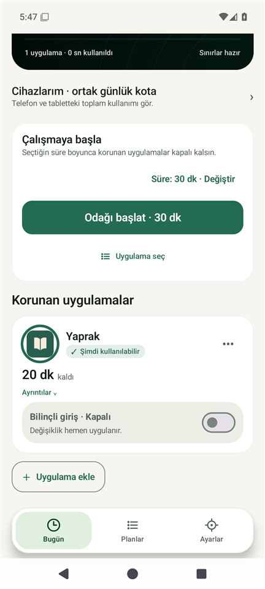 | 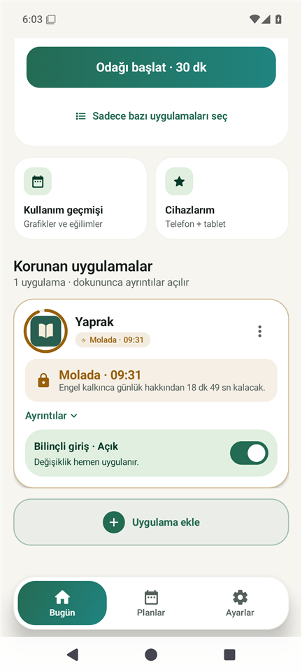 |
| 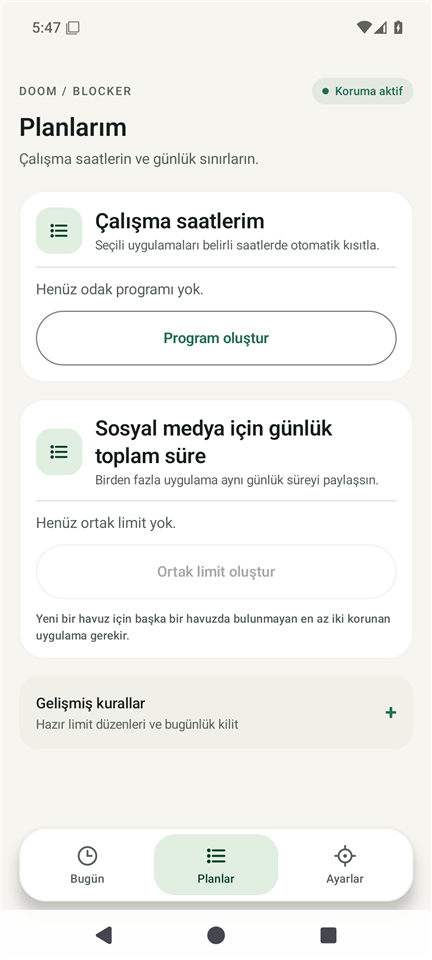 | 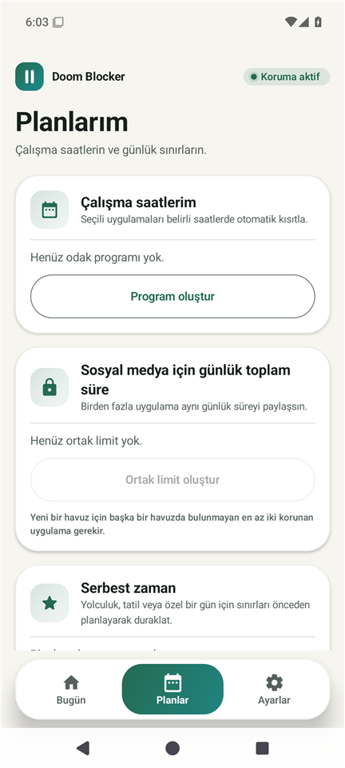 |
| 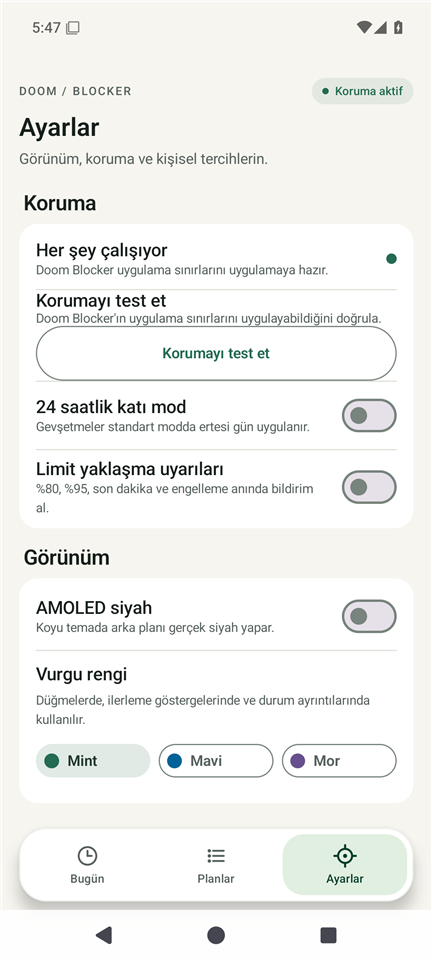 | 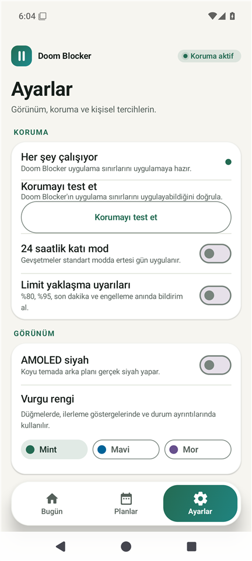 |

| Bilinçli giriş | Mola | Serbest zaman | Koyu tema |
|---|---|---|---|
| 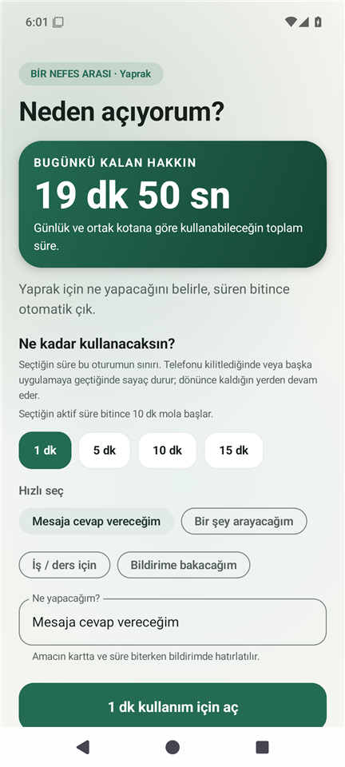 | 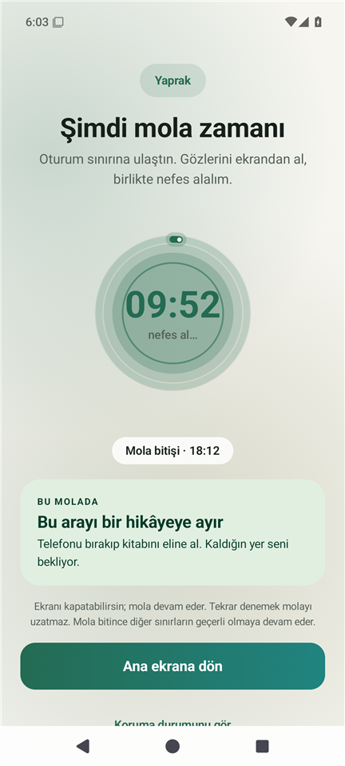 | 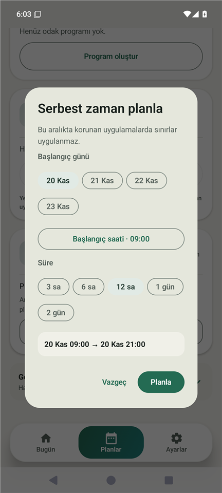 | 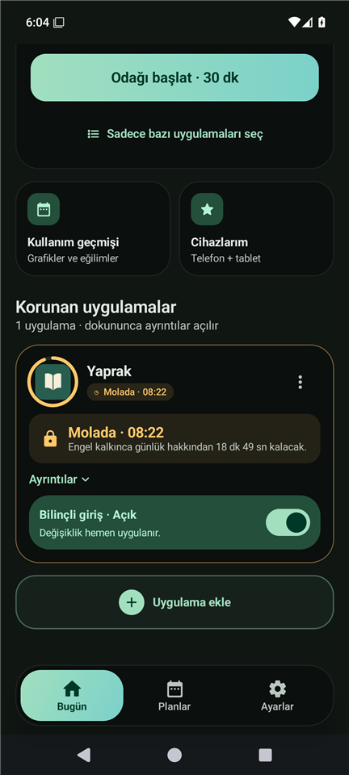 |
